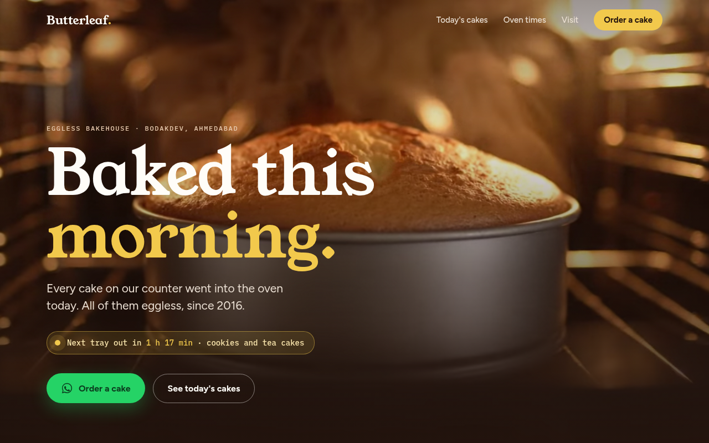
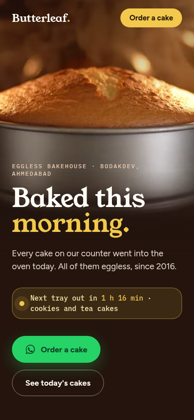
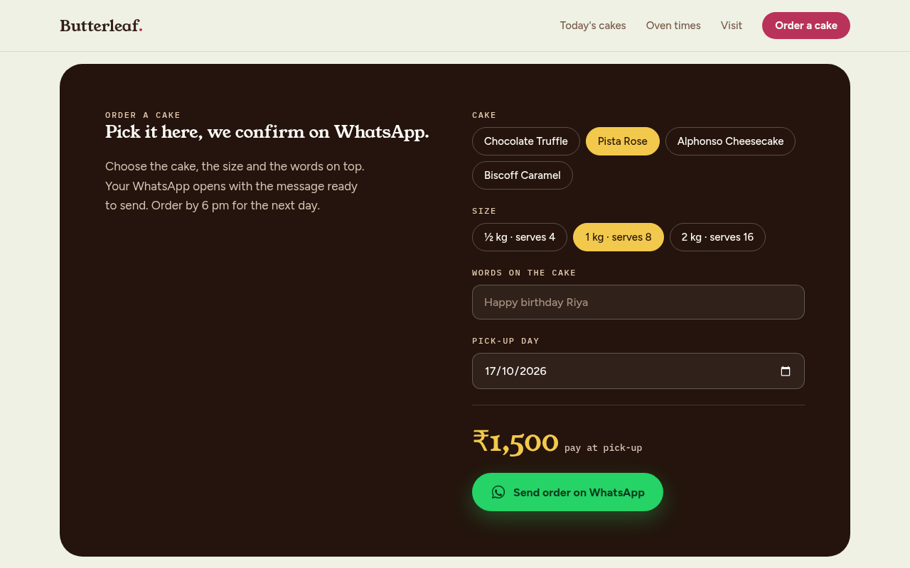

# Butterleaf Bakehouse · a bakery website with AI-made video



**Live:** https://sushmareshamwala.github.io/butterleaf-bakehouse/

## The problem
Most small-shop websites look like a template: stock photos, nothing moves, and no easy way to order. People look once and leave.

## The idea
I saw a honey brand's website on Instagram that looked like a real ad. I wanted the same feeling for a neighbourhood bakery, but built with free or cheap tools and one plain HTML file.

## What is on the page
- **A cake rising in the oven**, full-screen behind the headline. It is an 8-second AI video made in Google Flow (Veo), cut into a seamless loop of about 1 MB.
- **"From the kitchen":** two more Flow clips (ganache pour, pistachio cream piping). They play only while they are on screen.
- **A live oven timer:** "Next tray out in 1 h 16 min". It is worked out from the three baking times (7 am, 11 am, 4 pm) and your clock.
- **An order form:** pick the cake, the size and the words on top, and the price updates. The button opens WhatsApp with the order already written.
- **Phone first:** on a phone, the oven fills the top of the screen and the words sit under it.

| Phone | Order form |
|---|---|
|  |  |

## How it was made
| Part | Tool |
|---|---|
| Page (HTML, CSS, JS, one file, no build step) | Claude Code |
| 3 videos, 8 s each | Google Flow (Veo). The small "Veo" mark is left in on purpose |
| 4 cake photos | FLUX.1 schnell on Cloudflare Workers AI |
| Video loops and compression | ffmpeg |
| Hosting | GitHub Pages |

The prompts for the videos are in [FLOW-VIDEO.md](FLOW-VIDEO.md).

## Run it
```bash
git clone https://github.com/sushmareshamwala/butterleaf-bakehouse
cd butterleaf-bakehouse
python3 -m http.server 8000   # then open http://localhost:8000
```

Butterleaf is a made-up shop. The address and the WhatsApp number are placeholders.
